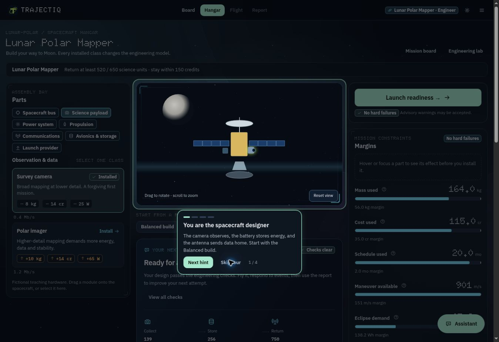
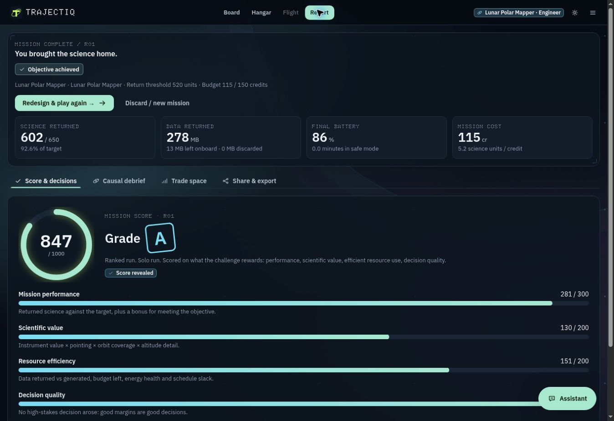
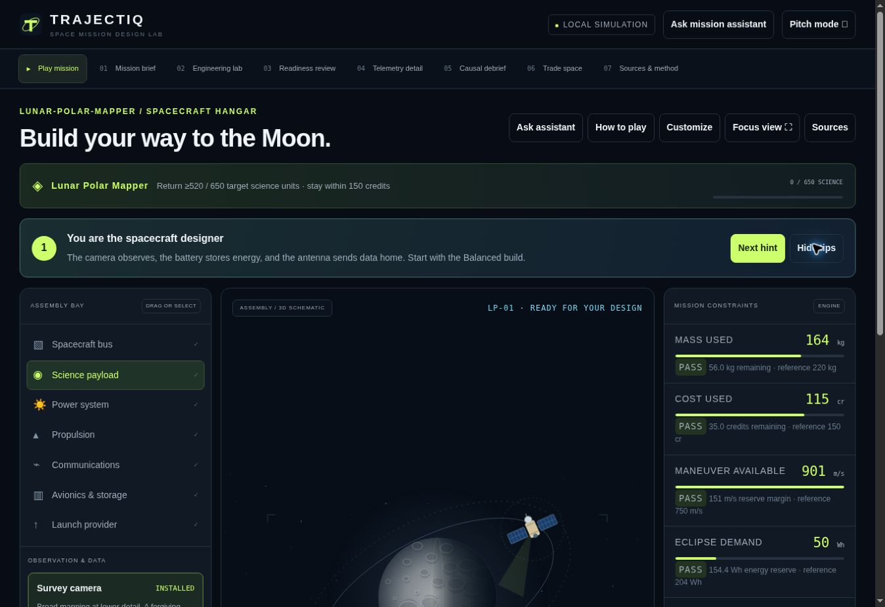

# TrajectIQ — Space Mission Design Game

**Design a spacecraft. Operate the mission. Understand the trade-offs.**

A team project by **Team Kemon Dilam Bondhura**, developed in the **NASA Space Apps Challenge 2026** project context. TrajectIQ is an educational browser game connecting spacecraft design choices to power, propulsion, data return and mission outcomes.

[](https://github.com/Raj2003-bubt/TrajectIQ/actions/workflows/ci.yml)

[Portfolio live demo](https://trajectiq-raj2003.vercel.app/) · [Original team source](https://github.com/Pranto-404/Trajectiq) · [Team demo](https://trajectiq-omega.vercel.app/) · [Integration audit](docs/UPSTREAM_INTEGRATION_20261120.md)

> This branch contains the React migration under review. The portfolio production demo may still run the previous release until the pull request is approved and deployed. The original team demo is maintained independently.

## Features

- **Eight destinations, ten scenarios:** Moon, Mars, Earth, Mercury, Venus, Vesta, Ceres and Europa, each with destination-specific constraints.
- **Solo, same-device Crew and Sandbox modes**, with Cadet, Engineer and Flight Director difficulties. Crew mode is pass-the-controls play, not online multiplayer.
- **Spacecraft design:** seven subsystem categories, orbital choices, mass/cost/schedule checks, power and storage margins, launch readiness and explicit warnings.
- **Mission operations:** deterministic simulation, resource-limited crisis choices, science return, causal debrief, decision replay and seeded robustness experiments.
- **Interactive visuals:** persistent Three.js spacecraft scene, orbit/camera controls and SVG fallback; responsive interface, light/dark themes and reduced-motion support.
- **Local persistence and sharing:** browser saves, validated legacy-save migration, mission codes, local leaderboard and report exports.
- **Offline mission assistant:** local rules, simulation-backed what-if experiments and bundled NASA/JPL reference facts. Optional server-side Gemini backup is described separately below.
- **Offline edition:** generated single-file React game using the SVG renderer; hosted caching after a successful first visit.

| Destination | Scenarios |
|---|---|
| Moon | Lunar Polar Mapper; Lunar Ice Hunter |
| Mars | Mars Polar Mapper; Mars Dust Season |
| Earth | Earth Observer on a Clock |
| Mercury | Mercury Thermal Squeeze |
| Venus | Venus Radar Cycles |
| Vesta | Dawn at Vesta |
| Ceres | Dawn at Ceres |
| Europa | Europa Clipper-style Orbiter |

Scenario names describe educational exercises. The Europa scenario is a simplified orbiter exercise, not a reproduction of the real Europa Clipper trajectory.

## Run locally

Requires **Node.js 22.12+** (Node 24 is also covered by CI) and npm.

```bash
git clone --branch feat/upstream-react-integration-20261120 https://github.com/Raj2003-bubt/TrajectIQ.git
cd TrajectIQ
npm ci --ignore-scripts
npm run dev
```

Open `http://127.0.0.1:5173`. For the production build:

```bash
npm run build
npm test
npm run preview
```

Preview: `http://127.0.0.1:4173`. `npm start` serves the built current app at `http://127.0.0.1:3000`.

For offline play, build first and open **`site/TRAJECTIQ_Play.html`**. On Windows, `START_GAME.bat` opens that file after it exists. `npm run standalone` also builds the current edition. The committed **`dist/TRAJECTIQ_Play.html` is an archived legacy edition**, retained for historical reproducibility.

## Architecture

**React 19 · Vite 8 · JavaScript ES modules · Zustand · Three.js / React Three Fiber / Drei · Motion · CSS modules · Service Worker · Node test runner · Vitest**

| Location | Purpose |
|---|---|
| `dist/data/` | Maintained source for bodies, NASA/JPL snapshots, fictional hardware and scenarios |
| `dist/engine/` | Maintained simulation, equations, assistant, scoring, replay and mission-code source |
| `src/store/` | Game state, save migration, validation and bounded optional AI requests |
| `src/features/` | Mission board, hangar, flight, reports, sheets and persistent 3D stage |
| `src/ds/`, `src/styles/` | Accessible control primitives, themes and responsive layout |
| `src/assets/` | Bundled textures/fonts and their attribution/license notices |
| `server/assist-core.js`, `api/assist.js` | Optional server-side Gemini proxy; no key is needed for core gameplay |
| `scripts/build.mjs` | Hosted build, generated service worker and current single-file edition |
| `site/` | Generated hosting output, ignored by Git |
| `tests/`, `tests-ui/` | Engine/security/build checks and React/store regression suites |

The directory name `dist/` is historical: it contains maintained engine/data source as well as the archived interface. Do not delete it as disposable build output. The Vercel output directory for this version is **`site`**.

## Verification

Fresh Linux / Node **24.22.3** checks during this integration passed:

- Reproducible installation with `npm ci --ignore-scripts`.
- Production hosted build, service worker and current standalone generation.
- **396 Node tests + 374 Vitest tests = 770 passing tests**, no Node failures/skips.
- `npm audit --json`: zero reported vulnerabilities across runtime and development dependencies at the time of checking.
- Archived standalone file unchanged from the reviewed upstream commit.

[PR CI run 44750288537](https://github.com/Raj2003-bubt/TrajectIQ/actions/runs/44750288537) passed installation, runtime dependency audit, build and both suites on Linux Node 22/24 and Windows Node 24 at application commit `136e753700b3b4c4a7e8868510622f0d7c19a437`. See [Actions](https://github.com/Raj2003-bubt/TrajectIQ/actions) for checks after documentation changes.

`npm run e2e` currently exits with an explicit “not configured” error: there is no Playwright test suite. Component tests use jsdom and emit canvas-not-implemented warnings; they do not prove GPU rendering or device compatibility. Browser evidence, unresolved checks and release gates are recorded in the [integration audit](docs/UPSTREAM_INTEGRATION_20261120.md).

## Assistant and privacy

The default verified assistant uses local rules and the actual mission engine. It can review designs, explain reference facts and preview bounded experiments without a network connection.

In the hosted version, **AI backup is enabled in preferences by default**. When local knowledge cannot answer, the client may send the question, a short mission summary and recent questions to this site's `/api/assist` function, which forwards them to Google Gemini when configured. Players can disable automatic backup in Tools & preferences. Generated replies are labelled as AI backup and are not verified by the game.

No provider credentials were added in this migration. To enable the optional backend, the project owner must configure a server-only `GEMINI_API_KEY` and a supported `GEMINI_MODEL` in the intended Vercel project. The existing fallback model identifier has not been verified against a live provider in this audit. Never use a `VITE_` prefix for a secret. Local `vite` preview is static and does not run Vercel functions; core gameplay remains available when the backend is absent.

The proxy checks origin/content type, bounds inputs, strips unsupported context fields, limits output and applies a timeout. In-memory rate limits are **per serverless instance**, not a global billing cap or authentication system. Do not treat an Origin header as protection against arbitrary non-browser clients. Provider quotas/spend controls require separate configuration. The standalone edition has no AI-network capability.

## Scientific basis and limitations

The game distinguishes sourced NASA/JPL body facts from mathematical relations and fictional game values. Its equations include the ideal rocket equation, circular two-body orbit period, a zero-beta central-shadow eclipse approximation, energy integration and unit conversions. It does not model full interplanetary transfer trajectories, landing, n-body dynamics, detailed RF budgets or complete thermal/radiation physics.

Hardware specifications, credits, science units, crises and many operating constraints are teaching assumptions. Bundled facts are snapshots, not live telemetry or current ephemerides. Scores and robustness indices are not real mission reliability estimates. Learning outcomes have not been measured in a user study.

References and in-game provenance: [body model](docs/ENGINE_BODIES.md), [scientific equations](docs/SCIENTIFIC_VALIDATION_V6.md), [NASA fact sheets](https://nssdc.gsfc.nasa.gov/planetary/factsheet/), [JPL Solar System Dynamics](https://ssd.jpl.nasa.gov/), [NASA Glenn rocket equation](https://www1.grc.nasa.gov/beginners-guide-to-aeronautics/ideal-rocket-equation/), [asset attribution](src/assets/ATTRIBUTION.md).

Saves stay in the current browser/device/origin; there is no cloud sync. Hosted offline use requires the initial cache to finish. Close old game tabs before expecting a waiting service-worker update to activate. A real-device Safari/Android, screen-reader and complete cache-upgrade test matrix remains necessary.

## Screenshots

These genuine captures were taken from the public deployments during the 20 November review. They are not captures of the exact migration preview.

**Original team deployment — React hangar**



**Original team deployment — completed mission report**



**Portfolio deployment — previous edition at review time**



See the audit for browser evidence and remaining candidate/device checks.

## Team, provenance and licensing

**Team Kemon Dilam Bondhura** — NASA Space Apps Challenge 2026 project context. This portfolio copy presents the work as a team project without individual contribution claims.

Original source: [Pranto-404/Trajectiq](https://github.com/Pranto-404/Trajectiq), integrated through commit `3bfe390c028e909d492c34fc09fbd4eb80f1ea51`. Original author records and Git ancestry are preserved by a normal merge. The portfolio owner previously confirmed republication permission from the rightsholders. See [provenance](docs/PROVENANCE.md) and the [original historical README](docs/HISTORICAL_SOURCE_README.md).

No blanket code LICENSE has been added or inferred. Bundled font license notices and NASA imagery credits are preserved. NASA does not endorse this application. Implementation includes Codex assistance. Older `V3`–`V6` reports and the previous portfolio deployment record remain historical evidence, not current verification claims.
